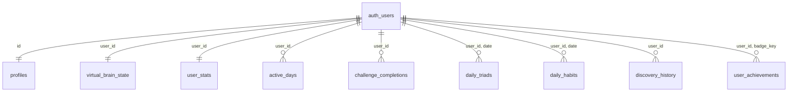

# Passagem de bastão: persistência por usuário com Supabase

> **Para quem vai conectar o Supabase (outro agente ou pessoa).** Este arquivo é
> autossuficiente: modelo de dados, decisões, mapeamento exato do que hoje fica
> no `localStorage`, protocolo de sincronização, passo a passo de configuração,
> mudanças necessárias no código e checklist de aceitação.
>
> **Estado em 21/10/2026:** o banco está **modelado e testado em Postgres real
> (26 testes)**, mas **nenhum projeto Supabase foi criado e nada foi conectado**.
> O app (`web/`) segue 100% local. Nada neste trabalho muda o comportamento atual
> do site publicado.

## 0. Resumo executivo

| | |
| :--- | :--- |
| **Objetivo** | Guardar o progresso **por usuário**, sobreviver à troca/limpeza do aparelho e (opcionalmente) sincronizar entre aparelhos. |
| **Princípio** | **Local-first.** O `localStorage` continua sendo a fonte da UI; o banco é a cópia durável. O app nunca pode ficar inutilizável sem rede ou sem conta. |
| **Identidade** | Login **anônimo** do Supabase por padrão (zero atrito para idosos), com **upgrade opcional** para e-mail (mesmo `user_id`, o progresso acompanha). |
| **Segurança** | RLS estrita (`auth.uid() = user_id`), `anon` sem acesso a nada, sem `service_role` no cliente. |
| **Consistência** | O progresso **nunca regride**: triggers do banco fazem *merge* monotônico, então um aparelho atrasado não apaga nada. |
| **Entregue** | 2 migrations + testes SQL + mapeador de referência (`sync-mapper.js`) com testes. |
| **Falta** | Criar o projeto, configurar auth, escrever o cliente (auth + fila de envio), UI de consentimento/conta, testes e2e, e validar contra o projeto real. |

### O que já está pronto neste repositório

| Arquivo | Para quê |
| :--- | :--- |
| `supabase/migrations/20260819120000_create_evermind_schema.sql` | Esquema v1 (já existia): `profiles`, `daily_triads`, `challenge_completions`, `virtual_brain_state`, `user_achievements`, RLS, triggers. **Não editar.** |
| `supabase/migrations/20261021000000_add_discovery_pillar.sql` | Novo valor `discovery` no enum de pilares (arquivo separado de propósito: limitação do Postgres). |
| `supabase/migrations/20261021000100_pwa_persistence.sql` | **O modelo novo**: ajustes no `profiles`, `user_stats`, `active_days`, `daily_habits`, `discovery_history`, colunas novas, triggers de merge, RLS, privilégios, `delete_my_account()`. |
| `supabase/tests/run-sql-tests.mjs` | 26 testes num Postgres real (PGlite): RLS, merge, idempotência, exclusão de conta, mapeador × banco. `cd supabase/tests && npm install && npm test`. |
| `web/js/domain/sync-mapper.js` | **Implementação de referência** (funções puras) de `buildPush` (estado local → linhas) e `mergePull` (banco + local → estado local). **Ainda não é carregada pelo app.** |
| `web/config.example.js` | Modelo do arquivo de configuração com URL e chave pública. |
| `supabase/schema.sql` | Snapshot do esquema **v1** (legado). A fonte da verdade são as **migrations**. Não aplicar os dois. |

---

## 1. Decisões tomadas (e por quê)

1. **Login anônimo + upgrade opcional (recomendado).** O público é sênior: pedir
   e-mail e senha na primeira abertura derruba o uso. O Supabase cria um usuário
   real (`is_anonymous = true`) sem formulário; `auth.uid()` existe, então o RLS
   funciona igual. Quando a pessoa quiser levar o progresso para outro aparelho,
   `supabase.auth.updateUser({ email })` converte o usuário anônimo em permanente
   **mantendo o mesmo `id`** (sem migrar dados).
   *Risco:* usuário anônimo que limpa o navegador **perde o acesso** à conta
   (o token some). Mitigação: oferecer "Guardar meu progresso com e-mail" em Ajustes.
2. **Local-first com fila de envio.** O app continua escrevendo no `localStorage`
   (ADR-0002). A sincronização é um processo separado, idempotente, que roda em
   segundo plano. Falha de rede nunca bloqueia a interface.
3. **Merge monotônico no banco (não só no cliente).** Um aparelho antigo com
   dados velhos não pode "regredir" o cérebro nem a sequência (regra de ouro do
   domínio, CONTEXT.md §4.1 e §4.3). Está nos triggers `merge_*`.
4. **Idempotência por chave determinística.** O log de atividades não tem ids no
   app. `event_key = "<data>|<atividade>|<nº de ordem no dia>"` (ex.:
   `2026-10-21|game:memory|2`) torna o reenvio seguro sem mudar o formato local.
5. **Tabelas pequenas e explícitas em vez de um blob JSON.** Permite constraints
   (`CHECK`), merge por coluna e consultas (ex.: dias ativos), e deixa o banco
   verificável pelos testes.
6. **Consentimento explícito.** Os dados são de bem-estar de idosos (sensíveis
   pela LGPD) e a tela de boas-vindas hoje promete **"Seus dados ficam só neste
   aparelho"**. Sincronizar **exige** opt-in e atualizar esse texto (§8).

---

## 2. Arquitetura

```
┌────────────────────── Aparelho (PWA, offline-first) ──────────────────────┐
│  Telas  ──►  localStorage (fonte da UI)                                   │
│                    │  mudou?                                              │
│                    ▼                                                      │
│            SyncManager (a escrever)                                       │
│   1. garante sessão (login anônimo, refresh do token)                     │
│   2. buildPush(snapshot)  ← web/js/domain/sync-mapper.js                  │
│   3. envia upserts idempotentes (lotes) com Bearer = access_token         │
│   4. pull → mergePull(snapshot, remote) → grava no localStorage           │
└───────────────────────────────┬───────────────────────────────────────────┘
                                │ HTTPS (PostgREST + GoTrue)
┌───────────────────────────────▼───────────────────────────────────────────┐
│ Supabase: auth.users (anônimo/e-mail) ─► tabelas com RLS + triggers merge │
└───────────────────────────────────────────────────────────────────────────┘
```

---

## 3. Modelo de dados



Toda tabela tem `user_id uuid DEFAULT auth.uid()` e `ON DELETE CASCADE` para
`auth.users`. **O cliente nunca precisa enviar `user_id`** (o RLS exige que seja o
do JWT de qualquer forma).

| Tabela | Cardinalidade | Conteúdo | Regra de merge (trigger) |
| :--- | :--- | :--- | :--- |
| `profiles` | 1 por usuário (criada no signup) | `display_name`, `onboarding_done`, `text_size_pct` (100/115/130), `sound_enabled`, `vibration_enabled`, `timezone` | último a escrever vence |
| `virtual_brain_state` | 1 | `current_stage` (enum), `total_points`, `total_completed_challenges` | `GREATEST` em tudo; estágio nunca regride |
| `user_stats` | 1 | sequência (`current_streak`, `last_active_date`, `total_active_days`), totais por pilar, contadores das telas | contadores `GREATEST`; **sequência: vale a de `last_active_date` mais recente** (pode recomeçar em 1 após pausa) |
| `active_days` | N (`user_id`,`date`) | dias com atividade | só inserção (`DO NOTHING`) |
| `challenge_completions` | N | log de atividades: `challenge_type`, `challenge_id`, `date`, **`event_key`** | só inserção; `UNIQUE(user_id,event_key)` |
| `daily_triads` | N (`user_id`,`date`) | `challenge_ids`, `completed_challenge_ids` | união dos concluídos |
| `daily_habits` | N (`user_id`,`date`) | caminhada, copos, meta da água, fruta, sono, ligação, lembrete | booleans só viram `true`; copos `GREATEST`; lembrete mantido |
| `discovery_history` | N | descoberta sorteada/concluída por dia | `completed_at` nunca volta a `NULL` |
| `user_achievements` | N (`user_id`,`badge_key`) | conquistas | vale o `unlocked_at` mais antigo |

**Enums e mapeamentos** (o app usa MAIÚSCULAS, o banco minúsculas):

| App | Banco |
| :--- | :--- |
| Estágio `BABY` `KID` `TEEN` `MEGA` | `baby` `kid` `teen` `mega_brain` |
| Pilar `MIND` `MOVEMENT` `SELFCARE` `CONNECTION` `DISCOVERY` | `mind` `movement` `selfcare` `connection` `discovery` |
| Badge `BADGE_FIRST_STEPS` / `_ACTIVE_WEEK` / `_MIND_IN_MOTION` / `_PRESENT_FRIEND` / `_WALKER` | `first_steps` / `active_week` / `moving_mind` / `present_friend` / `walker` |

`challenge_id` (o `k` do log) assume: `walk`, `water`, `fruit`, `sleep`, `call`,
`discovery`, `game:memory`, `game:sequence`, `game:words`, `game:attention`, `game:music`.
É `TEXT` livre de propósito: atividades novas não exigem migration.

**Limiares do estágio:** 1–5 baby, 6–20 kid, 21–50 teen, **51+** mega_brain
(o `schema.sql` v1 dizia "50+": só o comentário estava errado; a migration corrige).

---

## 4. Mapeamento `localStorage` → banco

Todas as chaves têm prefixo `evermind:` (acrescentado pelo `LocalStorageGateway`).

| Chave local | Campo | Tabela.coluna |
| :--- | :--- | :--- |
| `evermind_user_name` | nome | `profiles.display_name` (≤ 60 chars; `NULL` = sem nome) |
| `onboarding_done` | boas-vindas vistas | `profiles.onboarding_done` |
| `settings_text_size` | 100/115/130 | `profiles.text_size_pct` |
| `settings_sound` / `settings_vibration` | on/off | `profiles.sound_enabled` / `vibration_enabled` |
| `evermind_user_progress_v1` | `highestBrainStageAchieved` | `virtual_brain_state.current_stage` |
| | `growthPoints` | `virtual_brain_state.total_points` |
| | `totalCompletedChallenges` | `virtual_brain_state.total_completed_challenges` |
| | `currentStreak`, `totalActiveDays`, `lastActiveDate` | `user_stats.current_streak`, `total_active_days`, `last_active_date` |
| | `pillarTotals.{MIND,MOVEMENT,SELFCARE,CONNECTION,DISCOVERY}` | `user_stats.total_{mind,movement,selfcare,connection,discovery}` |
| | `activeDates[]` (últimos 60) | `active_days` (1 linha por data) |
| | `completionLog[]` = `{d,p,k}` (últimos 60 dias) | `challenge_completions` (`date`, `challenge_type`, `challenge_id`, `event_key`) |
| | `triadCompletions{data:[ids]}` | `daily_triads.completed_challenge_ids` |
| | `badges[]` = `{id, unlockedAt}` | `user_achievements` (`badge_key`, `unlocked_at`) |
| | `completedChallengeIds`, `triadDate`, `triadChallengeIds` | **não sincronizar** (legado, sem uso) |
| `evermind_habits_state_v1` | `movement.totalWalkSessions` | `user_stats.total_walk_sessions` |
| | `selfCare.totalSelfCareActions` / `totalWaterGlasses` | `user_stats.total_selfcare_actions` / `total_water_glasses` |
| | `selfCare.{waterGlassesCount,isWaterGoalMet,fruitVeggieConfirmed,sleepRoutineConfirmed}` e `movement.todayWalkCompleted` (**só do dia atual**, `selfCare.todayDate`) | `daily_habits` (1 linha, `date = todayDate`) |
| `evermind_social_state_v1` | `totalSocialConnections` | `user_stats.total_social_connections` |
| | `isConnectionCompletedToday`, `reminderScheduledTime` | `daily_habits.social_call_completed`, `reminder_time` |
| `evermind_mind_activities_count` | contador | `user_stats.mind_activities_count` |
| `evermind_completed_discoveries_count` | contador | `user_stats.completed_discoveries_count` |
| `evermind_discovery_history_v1` | `[{id,date,completed?}]` (14 dias) | `discovery_history` |
| `evermind_discoveries_done_today_v1` | derivável do histórico | não sincronizar |
| `*_backup`, `*_backup_2` | cópias de dados corrompidos | **nunca** sincronizar |

O app guarda só os **últimos 60 dias** de log e **só os hábitos do dia atual**;
o banco guarda o histórico completo (por isso o merge só traz de volta a janela de 60 dias).

---

## 5. Protocolo de sincronização

### 5.1 Quando
- Ao abrir o app (se opt-in ativo) e ao voltar a ficar online (`online`).
- Depois de cada atividade concluída, com **debounce de ~3 s**.
- Ao ficar em segundo plano (`visibilitychange` → `hidden`), tentativa best-effort.
- **Nunca** bloquear a UI esperando a rede. Sem rede: marcar "pendente" e tentar depois (backoff exponencial, máx. ~5 min).

### 5.2 Envio (push) — ordem e chamadas PostgREST
Autenticar com `Authorization: Bearer <access_token do usuário>` e
`apikey: <chave pública>`. **Não** usar a chave pública como Bearer
(isso faz a requisição agir como `anon`, que não tem acesso a nada).

| # | Tabela | Chamada | Observação |
| :--- | :--- | :--- | :--- |
| 1 | `profiles` | `PATCH /profiles?id=eq.<uid>` | linha já existe (trigger de signup) |
| 2 | `virtual_brain_state` | `PATCH ...?user_id=eq.<uid>` | trigger faz o merge |
| 3 | `user_stats` | `PATCH ...?user_id=eq.<uid>` | idem |
| 4 | `active_days` | `POST ?on_conflict=user_id,date` + `Prefer: resolution=ignore-duplicates` | |
| 5 | `challenge_completions` | `POST ?on_conflict=user_id,event_key` + `Prefer: resolution=ignore-duplicates` | enviar em lotes de ≤ 200 |
| 6 | `daily_triads` | `POST ?on_conflict=user_id,date` + `Prefer: resolution=merge-duplicates` | |
| 7 | `daily_habits` | `POST ?on_conflict=user_id,date` + `merge-duplicates` | |
| 8 | `discovery_history` | `POST ?on_conflict=user_id,discovery_id,shown_on` + `merge-duplicates` | |
| 9 | `user_achievements` | `POST ?on_conflict=user_id,badge_key` + `merge-duplicates` | |

`buildPush(snapshot)` já devolve exatamente esses corpos (um array por tabela;
`profile`, `virtual_brain_state` e `user_stats` são objetos). Como o merge está no
banco, **reenviar tudo a cada vez é seguro**; otimizar (enviar só o que mudou)
é opcional e pode ficar para depois.

### 5.3 Recebimento (pull) e merge
`GET` de cada tabela (RLS já filtra pelo usuário) → `mergePull(snapshotLocal, remote)`
→ gravar o resultado no `localStorage` e re-renderizar. Regras (iguais às do banco):
contadores/estágio/pontos = máximo; sequência = a do dia mais recente; conjuntos = união;
`unlockedAt` = o mais antigo; hábitos do dia só se `date` = dia local atual.
**Preferências do aparelho** (tamanho do texto, som, vibração) **não** são sobrescritas
pelo banco; o **nome** local tem prioridade (o do banco só preenche se o local estiver vazio);
`onboarding_done = true` no banco evita repetir as boas-vindas num aparelho novo.

### 5.4 Primeiro vínculo e conta nova
- **Aparelho com progresso local + usuário novo no banco:** faz *push* de tudo (o banco está vazio, nada a mesclar).
- **Aparelho novo + conta existente (e-mail):** *pull* primeiro, depois *push* do resultado mesclado.
- **Nunca** apagar dados locais por causa do banco; só mesclar.
- Usar `profiles.timezone` (`Intl.DateTimeFormat().resolvedOptions().timeZone`) e manter as **datas locais** (ADR-0009): `date` é o dia local do usuário, não UTC.

### 5.5 Erros
`401` → renovar token e repetir; `403`/RLS → bug (registrar, não repetir em loop);
`409`/duplicado → tratar como sucesso (idempotente); `5xx`/rede → backoff.
Mensagens ao idoso em pt-BR, sem jargão e **sem culpa** ("Seu progresso está salvo neste aparelho.").

---

## 6. Configuração do Supabase (passo a passo)

1. Criar o projeto em <https://supabase.com/dashboard> (região **South America (São Paulo)** reduz a latência).
2. **Authentication → Sign In / Providers:** ativar **Anonymous Sign-Ins**; manter **Email** ativo (para o upgrade por *magic link* / OTP).
3. **Authentication → URL Configuration:** *Site URL* = `https://luisabrantes.github.io/everMind/`; *Redirect URLs*: o mesmo + `http://localhost:8080/*` (desenvolvimento).
4. **Anti-abuso:** logins anônimos têm limite por IP; ativar **CAPTCHA (Turnstile/hCaptcha)** em *Authentication → Attack Protection* antes de abrir ao público.
5. Aplicar as migrations (na ordem, que o nome dos arquivos já garante):
   ```bash
   brew install supabase/tap/supabase        # ou: npx supabase
   supabase login
   supabase link --project-ref <REF_DO_PROJETO>
   supabase db push                          # aplica supabase/migrations/*.sql
   ```
   Alternativa sem CLI: colar os 3 arquivos de `supabase/migrations/`, em ordem, no *SQL Editor*
   (rodar `20261021000000_...` **sozinho** e confirmar antes de rodar o seguinte).
6. **Settings → API:** copiar a **Project URL** e a chave **publishable** (ou `anon`, em projetos antigos).
7. Criar `web/config.js` a partir de `web/config.example.js` com esses dois valores e
   carregá-lo **antes** dos scripts de sincronização no `index.html`. A chave publishable
   **é pública por desenho** (protegida pelo RLS) e o site é estático (GitHub Pages, sem build),
   então o arquivo **precisa ser commitado** para chegar ao ar.
   ⚠️ **Nunca** colocar a `service_role`/`secret` key no repositório nem no cliente.

**Dados de teste:** usar um projeto Supabase separado (ou *branch*) para desenvolvimento;
não testar contra o projeto que terá usuários reais.

---

## 7. O que mudar no código web

### 7.1 Substituir/descartar
| Arquivo | Problema | Ação |
| :--- | :--- | :--- |
| `web/js/domain/supabase-client.js` | usa a chave pública como `Bearer` (vira `anon`); sem login; só `upsert` | trocar por cliente com sessão (recomendado: **SDK `@supabase/supabase-js` v2 hospedado em `web/vendor/`**, versão fixa; cuida de token, refresh e e-mail OTP) |
| `web/js/domain/supabase-sync.js` | grava em `user_progress_sync` (**tabela inexistente**) com `userId = 'local_user_demo'` (não é UUID) | substituir por `SyncManager` que usa `sync-mapper.js` e as tabelas acima |
| `web/js/screens/weekly-summary.js` (botão "Guardar cópia de segurança") | acoplado ao módulo antigo | religar ao novo `SyncManager` |

Sem build e offline-first: **baixar o UMD do SDK para `web/vendor/`** (não usar CDN em
runtime, já que o app promete carregar só do próprio domínio e há um teste e2e que exige isso),
adicioná-lo ao `APP_SHELL` do `sw.js` e subir o `CACHE_NAME`.

### 7.2 Adicionar
- `web/js/domain/sync-mapper.js` (já existe) ao `index.html` e ao `APP_SHELL`.
- `SyncManager` (sessão anônima → push/pull → fila/backoff → estado `idle|pending|error|offline`).
- **UI em Ajustes → "Guardar meu progresso"**: opt-in, status ("Salvo na nuvem às 14:32"),
  "Usar com e-mail" (upgrade), "Excluir minha conta" (chama `rpc/delete_my_account`).
- Ajustar o texto da tela de boas-vindas (passo 3) e o rodapé de Ajustes: hoje dizem
  "Seus dados ficam só neste aparelho". Com sincronização ativa isso passa a ser **falso**.

### 7.3 Service worker
Já ignora `/rest/v1/`. Acrescentar `/auth/v1/` e `/functions/v1/` à exceção (hoje passam
direto por serem de outra origem, mas deixar explícito evita regressão). Lembrar de subir o `CACHE_NAME`.

### 7.4 Testes a manter/atualizar
- A suíte e2e (`cd web/tests && npm test`, 537 testes) tem um teste "app só carrega recursos do
  próprio domínio" — ele deve continuar passando **sem** `config.js` configurado
  (sync desligada por padrão) e ser estendido para o caso com sync ligada (requisições só ao host do Supabase).
- Adicionar e2e com a rede **mockada** (`page.route`) cobrindo: opt-in, fila offline → online,
  `401` com refresh, exclusão de conta, e que **nenhuma** requisição ao Supabase sai sem consentimento.

---

## 8. Segurança e privacidade

- **RLS:** todas as tabelas têm RLS com `TO authenticated` + `(select auth.uid()) = user_id`
  (USING e WITH CHECK). `anon` não tem nenhum privilégio. Usuários anônimos do Supabase usam o
  role `authenticated`, então os mesmos policies valem. Testado (`supabase/tests`).
- **Chaves:** só a publishable/anon no cliente. `service_role` jamais.
- **LGPD:** dados de hábitos e saúde de idosos são **dado pessoal sensível**.
  1. **Opt-in** claro, em linguagem simples, antes da primeira sincronização; recusar não pode reduzir nenhuma função do app.
  2. **Exclusão:** `delete_my_account()` apaga o usuário e, em cascata, tudo (testado).
  3. **Minimização:** não coletar nome completo, e-mail só no upgrade opcional, nem localização.
  4. Publicar uma política de privacidade curta e linkar em Ajustes (**decisão do dono do projeto**).
- **Abuso:** CAPTCHA no login anônimo; `CHECK`s no banco limitam tamanhos e faixas; considerar limite de tamanho de lote no cliente.
- **Texto de privacidade atual** a revisar: boas-vindas (passo 3) e rodapé de Ajustes.

---

## 9. Verificação

### 9.1 Já provado (rodar: `cd supabase/tests && npm install && npm test`)
26 testes em Postgres real (PGlite) cobrindo: criação de usuário (perfil/cérebro/stats, anônimo sem nome,
backfill de usuário antigo); migrations idempotentes; RLS (isolamento, `WITH CHECK`, `anon` sem acesso, `user_id` automático);
CHECKs; **merge monotônico** (contadores, sequência por data, estágio, hábitos, descobertas, tríade, conquistas);
idempotência por `event_key` e pilar `discovery`; exclusão de conta em cascata e só do próprio usuário;
e o **ciclo completo do mapeador** (estado local → banco → aparelho novo recupera tudo; reenvio não duplica;
aparelho atrasado não regride; dois aparelhos convergem).

### 9.2 NÃO provado (exige o projeto Supabase real)
O PGlite usa um esboço de `auth` e roles. Ainda é preciso validar no projeto real:
- login anônimo e upgrade para e-mail mantendo o `user_id`;
- que `anon` realmente recebe `permission denied` pela Data API;
- `delete_my_account()` removendo o usuário em `auth.users` (privilégios reais do `SECURITY DEFINER`);
- que o trigger `on_auth_user_created` roda no signup anônimo;
- latência e comportamento com rede ruim.

### 9.3 Teste de fumaça (substituir os `<>`)
```bash
URL=https://<REF>.supabase.co ; KEY=<publishable key>
# 1) login anônimo → access_token
TOKEN=$(curl -s -X POST "$URL/auth/v1/signup" -H "apikey: $KEY" -H "Content-Type: application/json" -d '{}' | jq -r .access_token)
# 2) sem token: deve falhar
curl -s "$URL/rest/v1/user_stats" -H "apikey: $KEY" -H "Authorization: Bearer $KEY"        # esperado: [] ou 401/permission denied
# 3) com token: deve devolver a linha criada no signup
curl -s "$URL/rest/v1/user_stats" -H "apikey: $KEY" -H "Authorization: Bearer $TOKEN"
# 4) idempotência do log
for i in 1 2; do curl -s -X POST "$URL/rest/v1/challenge_completions?on_conflict=user_id,event_key" \
  -H "apikey: $KEY" -H "Authorization: Bearer $TOKEN" -H "Content-Type: application/json" \
  -H "Prefer: resolution=ignore-duplicates,return=minimal" \
  -d '[{"challenge_type":"mind","challenge_id":"game:memory","date":"2026-10-21","event_key":"2026-10-21|game:memory|1"}]'; done
curl -s "$URL/rest/v1/challenge_completions?select=count" -H "apikey: $KEY" -H "Authorization: Bearer $TOKEN"   # esperado: 1
# 5) exclusão
curl -s -X POST "$URL/rest/v1/rpc/delete_my_account" -H "apikey: $KEY" -H "Authorization: Bearer $TOKEN"
```

### 9.4 Critérios de aceitação
1. Sem `config.js` ou sem opt-in: **zero** requisições ao Supabase; app idêntico ao atual; 537 testes e2e passando.
2. Com opt-in e sem rede: tudo funciona; ao voltar a rede, sincroniza sem duplicar.
3. Dois aparelhos com o mesmo e-mail convergem; nada regride; nada some.
4. "Excluir minha conta" apaga tudo e o app volta ao estado inicial.
5. Nenhuma mensagem de erro culpa ou assusta o usuário.
6. `supabase/tests` e `web/tests` passam; novas migrations são **aditivas** e idempotentes.

---

## 10. Decisões em aberto (precisam do dono do projeto)

1. **Anônimo + upgrade (recomendado)** ou exigir e-mail desde o início?
2. Quem é o responsável legal e qual é a **política de privacidade** a publicar? (LGPD)
3. Habilitar **CAPTCHA** (recomendado) antes de abrir ao público?
4. O projeto Supabase será criado em qual conta/organização, e quem guarda as credenciais?
5. Haverá **painel para professores/familiares** acompanharem o progresso? (Mudaria o modelo de RLS: hoje cada pessoa só vê o próprio; compartilhamento exigiria tabela de vínculos e consentimento explícito.)
6. Reter dados por quanto tempo? (Sugestão: apagar contas anônimas inativas há 12 meses, via job agendado.)

---

## 11. Observações e armadilhas

- **Não editar** a migration `20260819120000_...` (já pode ter sido aplicada em algum lugar). Mudanças novas = nova migration **aditiva**.
- **`ALTER TYPE ... ADD VALUE`** não pode ser usado na mesma transação em que é criado; por isso é um arquivo à parte.
- **`event_key`** é o contrato de idempotência: se mudar o formato (`<data>|<k>|<n>`), registros antigos duplicam. Mudar o formato só com migration de reescrita.
- **`GREATEST` em `current_stage`** funciona porque o enum é declarado em ordem (`baby < kid < teen < mega_brain`). Não reordenar o enum.
- **Datas:** sempre `YYYY-MM-DD` **locais** (ADR-0009). Não usar `toISOString().slice(0,10)` (é UTC).
- **O app só guarda 60 dias** de log e os hábitos de **hoje**; não esperar poder reconstruir histórico antigo a partir do `localStorage`.
- `supabase/schema.sql` é o snapshot **v1**; para o estado atual, aplicar as migrations.
- O harness de teste usa um esboço do `auth`; ao subir o projeto real, rodar também os testes do §9.3.
- Cuidado com o limite do GitHub Pages/CDN: `sw.js` e `config.js` não devem ficar em cache longo (o SW já revalida; manter `CACHE_NAME` atualizado pelo deploy).
